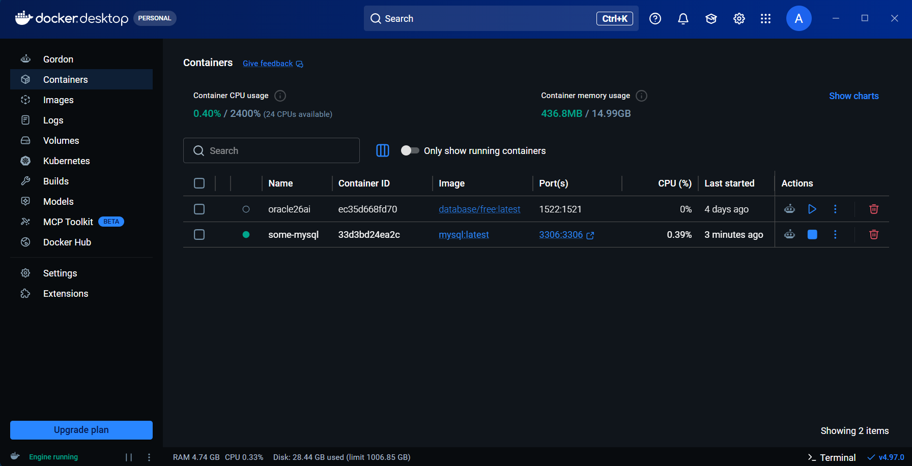
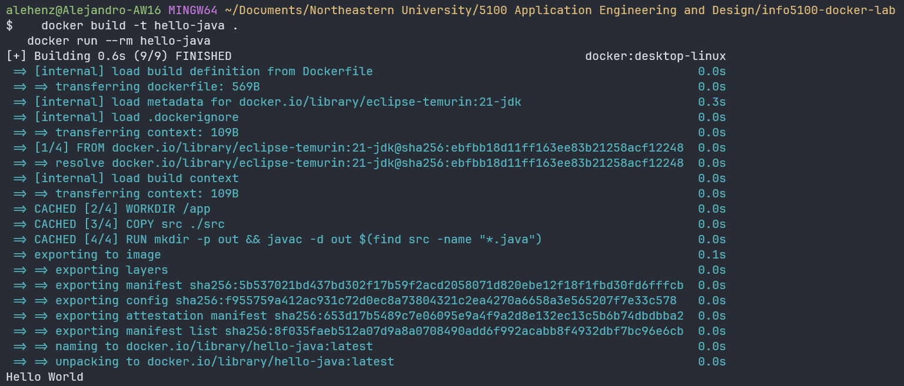
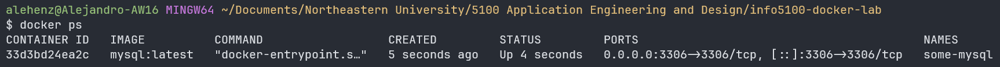
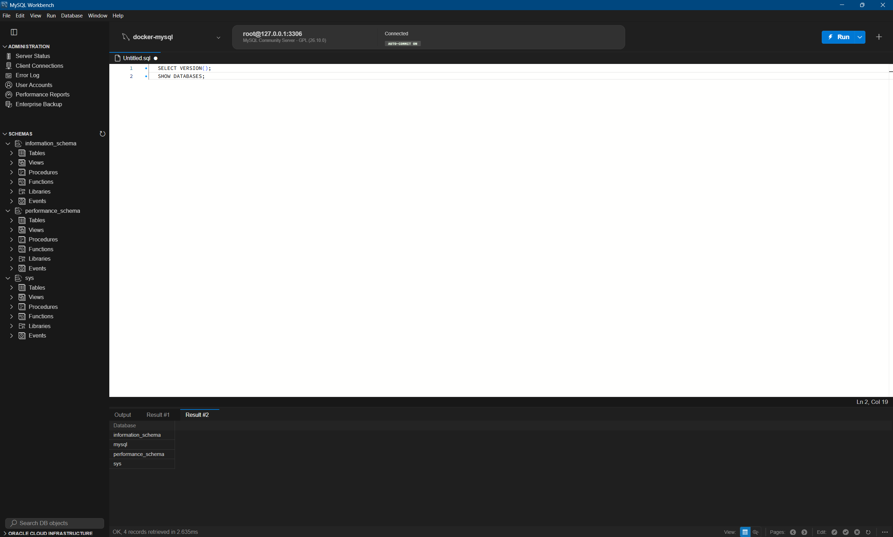

# Docker Lab

INFO 5100 Application Engineering and Development, Northeastern University Toronto.

**Author:** Alejandro Henriquez

This lab uses Docker Desktop to package a simple Java Hello World program as an image and run it as a container, then runs a MySQL database server in another container that a desktop client connects to.

## Contents

| Item | What it is |
|---|---|
| `Dockerfile` | Builds an image of the Hello World program from `src/` |
| `src/` | Java source of the program |
| `screenshots/` | Evidence that each step ran |

## 1. Build and run the Hello World image

```bash
docker build -t hello-java .
docker run --rm hello-java
```

`docker build` reads the `Dockerfile`, compiles the code inside the image, and tags the image `hello-java`. `docker run` starts a container from it. The program prints `Hello World!` and exits, and `--rm` removes the container afterward.

## 2. Run MySQL in a container

```bash
docker pull mysql
docker run --name some-mysql -e MYSQL_ROOT_PASSWORD=my-secret-pw -p 3306:3306 -d mysql:latest
docker ps
```

`-p 3306:3306` maps port 3306 of the container to port 3306 on this computer, so programs on the host can reach the database. `-d` runs the container in the background. The root password is the lab's example value and is for local practice only.

## 3. Connect with MySQL Workbench

| Setting | Value |
|---|---|
| Hostname | `127.0.0.1` |
| Port | `3306` |
| Username | `root` |
| Password | `my-secret-pw` |

## Screenshots

**Docker Desktop with the running containers**



**Building and running the Hello World image**



**MySQL container running**



**MySQL Workbench connected to the container**


